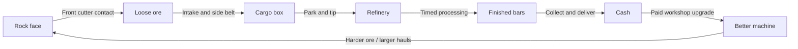

# Quarry Shift — mechanics and design breakdown

Quarry Shift is a portrait 3D mining-company prototype built around a visible production chain. The central design goal is to let a viewer infer the action from the machine, moving material and growing cargo pile before reading instructions.

This document describes the implemented prototype. Design intentions are not evidence of player preference or commercial performance.

## The complete loop

The player taps a rock to route toward it or drives manually with the joystick/WASD/arrows. Only the front cutter damages a seam. Lower portions break first, followed by loose material that must actually be collected. Ore then travels along the machine's visible conveyors into its rear skip.

Inventory is the source of truth. Material still travelling along a belt is excluded from the rendered cargo pile, so the same chunk is not shown twice. A full vehicle cannot collect beyond its capacity; overflow stays in the world.

At the refinery, the vehicle stops, parks and raises its skip before transferring ore. The furnace consumes input over time and produces finished bars at a separate collection pad. The player then collects those bars and delivers them to the selling point. Raw ore cannot generate cash directly.

## The first minute

The short guided demo opens with a crusher already touching the rock face. That is an earned checkpoint, reached through the original on-foot mining/refining/selling loop, earned contract rewards, a paid rental and physical driving before the first displayed frame. It is not created by seeding an inventory or granting free machinery.

The sequence shows cutting, a readable first conveyor load, refinery delivery, finished-bar collection, a sale, a paid cutter upgrade and copper mining. The first load pauses before the next cut so a viewer has time to follow the ore's route. The complete sequence takes about 47 seconds of simulation in the automated 30/60 Hz checks.

Those checks are deterministic gameplay validation, not a measured mobile frame rate or ad-performance result. Normal play keeps player control and uses the same movement, economy and production rules.

## A concrete economy trace

The current guided demo provides a small, auditable example:

| Moment | What happens |
| --- | --- |
| Earned crusher opening | The wallet contains $14 after the preparatory gameplay and paid rental. |
| First haul | The machine collects 12 real limestone units. |
| Refinery | Those units are deposited and processed into finished stone bars. |
| Collection | The showcase loads six finished bars for its sale. |
| Sale | Six stone bars at $8 each earn $48, taking the wallet from $14 to $62. |
| Cutter upgrade | The workshop charges $40, leaving $22. The cutter changes visibly and can reach copper. |
| Remaining material | Six finished stone bars remain at the refinery; no material disappears to simplify the sequence. |

The balances are prototype tuning values, not real money or revenue. Changing them should preserve the conservation relationship between mined ore, held inventory, refinery stock and sold bars.

## Decisions created by the loop

**Capacity determines trip frequency.** A larger cargo skip extends a mining run before the next refinery trip. The hotbar separates raw ore and finished bars so the player can understand what is occupying space.

**Power determines access.** Harder ore needs stronger tools. The cutter upgrade changes the actual machine silhouette, giving the purchase a visible result as well as a numeric benefit.

**Speed changes travel cost.** Movement still takes physical routes between the rock, refinery, output pad, depot and workshop. Engine upgrades improve those repeated trips.

**Fuel and rental time create operating constraints.** They are consumed during actual machine activity, including travel, cutting, loading and tipping. Idle reading does not drain them. Expired rentals and empty fuel produce recovery prompts; the player can leave the vehicle and recover on foot.

**Refining separates production from payment.** The player must transform ore into a finished product and deliver it before receiving cash. A furnace upgrade changes the production bottleneck rather than creating passive remote income.

## From player to company

The player can exit the vehicle and use a pickaxe and backpack. This provides both an earlier progression scale and an on-foot recovery path. The company menu contains equipment, crew, research and the five-quarry map rather than placing every system on the permanent HUD.

Three named helpers cover mining, logistics and sales. They are physical actors: they move through the quarry, carry actual materials, deliver them, collect output and sell. Workers have stamina, rest and recover; a funded meal speeds recovery. Gear/training purchases improve their capabilities, and gems can provide immediate rest.

Research spends earned gold on permanent bonuses to mining power, capacity, sale prices or fuel efficiency. Contracts supply explicit objectives and once-only rewards. These systems extend the same physical production loop instead of replacing it with arbitrary income counters.

## Five finite quarries

| Quarry | Progression emphasis |
| --- | --- |
| Limestone Yard | Establish the loop and improve tools enough to reach copper and gold. |
| Copper Ridge | Richer copper and access to the hydraulic breaker. |
| Golden Basin | Gold terraces requiring level-3 tools or the breaker. |
| Redrock Canyon | Tougher mixed deposits that benefit from trained crew and faster refining. |
| Summit Quarry | Finish the final site and sell every remaining bar. |

Each quarry has an authored layout, hardness, palette, brief and completion reward. Clearing rock is insufficient if materials remain held or unsold. Completing a site pays its reward once, then opens the next. Cash, research, equipment and crew carry forward. The fifth quarry ends the campaign; there is no invented sixth level or repeatable final reward.

## Why the presentation is restrained

The permanent HUD keeps cash, the quarry objective, inventory and the next contextual action. When carrying raw ore it points toward refining; finished bars point toward selling. Queued/ready production points toward collection, while fuel and rental problems take priority over ordinary travel prompts.

Rosa gives short, dismissible, nonblocking messages for full loads, hard ore, blocked paths, equipment and recovery. Messages expire and do not restart every frame. The short CPI-style sequence suppresses extra dialogue and company controls so the machinery remains the main explanation.

The teal/ivory/gold interface separates chrome, readable content and primary actions. Original illustrated icons and the foreman's portrait keep the game style coherent across the HUD, company menu and speech bubbles. English and Armenian are display variants; they do not change prices, actor IDs or saves.

## Engineering that supports the design

- Navigation respects the full machine footprint, including its cutter, during movement and turning. A visually wide vehicle cannot take a human-sized path through rock.
- Production follows parked transfer and actual stock. Sale effects cannot add income independently of sold inventory.
- Ore, debris and coin effects use bounded pools; they illustrate events rather than controlling balances.
- Five-level progression and local saves use explicit, validated state. Corrupt/future saves are kept and reported rather than silently replaced.
- Guided demonstrations and ordinary play have isolated save behavior. Watching a demo does not overwrite the company.
- The renderer uses Three.js, native antialiasing, toon materials and a directional shadow without fullscreen postprocessing. These are implementation choices, not a claim of sustained performance on every device.

## Current scope and useful next questions

The prototype runs locally in a WebGL 2 browser and can be exported as one self-contained HTML file. It is deliberately silent and has no account, backend, cloud saves, ad SDKs or real-money purchases.

Developer feedback is most useful around the loop itself: whether the conveyor/loading action reads clearly, whether refinery trips remain interesting as capacity grows, and whether crew automation preserves satisfying player decisions. Progression pacing and onboarding still benefit from observation with new players.

No CPI, retention, revenue, publisher acceptance or market-validation result is claimed. Gameplay inspiration is [Bulldozer Master: Crush & Mine](https://play.google.com/store/apps/details?id=io.supercent.bulldozermasters); Quarry Shift's code-native artwork, branding and tuning are original to this project.

The editable source is private. The public showcase includes only presentation material and compiled browser builds, whose shipped JavaScript remains inspectable.
