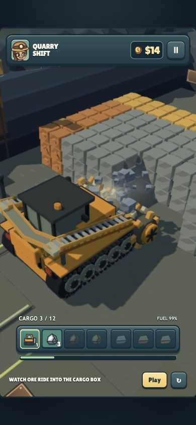
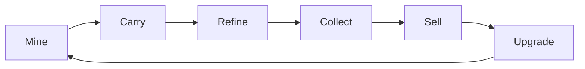

# Quarry Shift

**Break rock. Build a company.**

A playable portrait 3D mining-company prototype by [SonaArajyan03](https://github.com/SonaArajyan03). Follow each haul through the crusher, side conveyor, cargo box, refinery and sale, then reinvest in equipment and a physical quarry crew.



## Play and explore

The public GitHub Pages presentation includes a manually playable English prototype, an automatic guided demo, screenshots and an interactive breakdown of the core loop. The game runs locally in a WebGL 2-capable browser and needs no account. Use mouse/touch to choose a rock or destination; use the joystick, WASD or arrow keys to steer.

## The mechanics

| Step | Player action | Visible consequence |
| --- | --- | --- |
| Mine | Drive the front cutter into a seam. | The lower rock face fractures into real material units. |
| Carry | Pick up loose ore. | Ore rides a modeled side belt into a capacity-limited skip. |
| Refine | Park and tip at the refinery. | Input stock is processed into finished bars over time. |
| Sell | Collect finished bars and deliver them to the depot. | Actual sold bars generate cash. Raw ore cannot be sold directly. |
| Upgrade | Pay for workshop upgrades or hire crew. | The next haul changes through power, capacity, speed or physical automation. |

Five authored quarries give progression an ending. Crew members mine, carry, sell and rest using the same world. Validated local saves resume the company, while demo runs are isolated from player progress.

## For developers

- Full chassis/cutter collision footprints and physical routes.
- Material conservation from rock to bar to cash; no double-counted conveyor cargo.
- Context-sensitive next actions and readable recovery prompts.
- Paid, visibly different cutter upgrades.
- Finite five-level progression, once-only rewards and local save validation.
- A guided sequence using actual gameplay APIs and earned purchases.

Built with Three.js, JavaScript, original code-native art and DOM/SVG UI. The guided demo lasts roughly 47 seconds of simulation. This is a work-in-progress prototype, with no claimed CPI, retention, revenue or market-validation result.

Read the [full mechanics and design breakdown](DESIGN.md) for the concrete economy trace, progression decisions, crew behavior, UI rationale and system contracts.

## Why each step exists

Capacity gives the player a reason to leave the rock face. Refining changes raw material into a sellable product and creates a production bottleneck. Selling connects the visible work to a reward. Paid upgrades change the next haul through power, capacity or travel speed. Workers extend those same jobs with physical movement, actual inventory and stamina/rest.



The guided demo makes that loop concrete: an earned opening wallet of **$14**, a **12-unit limestone haul**, **six finished bars sold for $48**, then a **$40 cutter upgrade**. The wallet ends at **$22**, and the other six finished bars remain in the refinery. These are game-balance values, not real-money metrics.

## Progression and company systems

The five quarries progress from Limestone Yard to Copper Ridge, Golden Basin, Redrock Canyon and Summit Quarry. Hardness, resource mixes and authored layouts change the work. Completing a site requires clearing its seams and selling its remaining stock; rewards are paid once, and the final quarry ends the campaign.

The company menu covers machine rentals and fuel, personal tools/backpacks, cutter/cargo/engine/furnace upgrades, a physical automatic hauler, three hireable workers, gold-funded permanent research and the quarry map. The player can leave the machine and work on foot. Recovery guidance takes priority when fuel or rental time expires.

## What the prototype investigates

The design intention is to make the action understandable from the first visible rock contact. The cutter, fracture, conveyor and cargo pile explain the interaction, while the next-action button follows the current inventory. Secondary production, crew and contract detail stays in menus.

The engineering challenge is keeping those visuals honest: only the front cutter damages rock; routes respect the full vehicle footprint; parked/tipping transfers move real stock; bars create income only when sold; and in-transit ore is not duplicated in the cargo pile.

Useful feedback includes whether loading is readable, when refinery travel becomes repetitive, how upgrades change decisions and where automation helps or reduces engagement. This is an invitation for prototype feedback, not a claim that these questions have been validated with players.

## Repository boundary

This public repository contains the presentation, screenshots and compiled browser builds under `play/`. The editable game source is maintained privately. Compiled browser code is publicly inspectable; no source tree, source map or project-source ZIP is included here.

To preview this static showcase locally:

```sh
python3 -m http.server 8772 --bind 127.0.0.1
```

Open `http://127.0.0.1:8772`. GitHub Pages publishes from `main` at the repository root; `.nojekyll` keeps the static files unchanged. No custom Actions workflow is required.

Questions and developer feedback are welcome through this repository's issues. See [third-party notices](THIRD_PARTY_NOTICES.md). Original project code/artwork is not offered under an open-source license.
